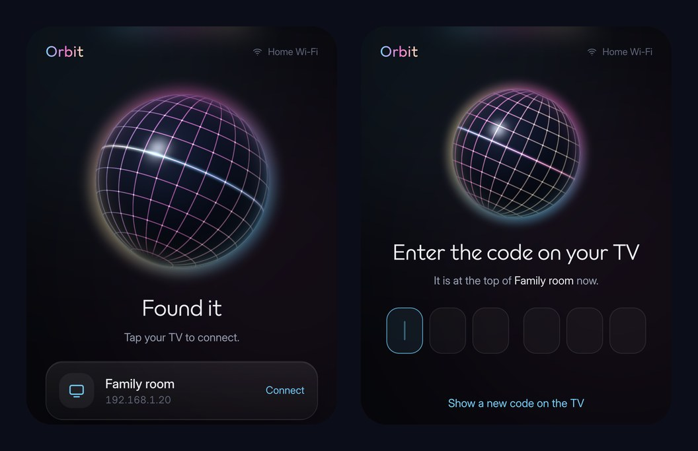
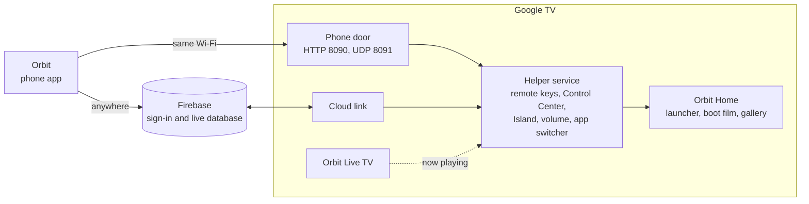

<p align="center">
  <picture>
    <source media="(prefers-color-scheme: dark)" srcset="docs/assets/banner-dark.png">
    
  </picture>
</p>

<p align="center">
  <a href="#what-you-get">What you get</a> ·
  <a href="#how-it-fits-together">How it fits together</a> ·
  <a href="#build-and-install">Build and install</a> ·
  <a href="#roadmap">Roadmap</a>
</p>

<p align="center">
  
  
  
  
</p>

Orbit OS replaces the stock home screen of a Google TV with its own: a curved gallery of your apps, a pull-down
Control Center, notifications that glow along the top edge, a Live TV app and a film that plays when the TV starts.
**Orbit**, the phone app, is its remote, on the same Wi-Fi or from anywhere, down to seeing the TV's screen and
pressing its buttons for someone at home.

It runs on top of Google TV: no root, no unlocked bootloader, no factory reset. What it switches off is disabled,
never uninstalled, and one command brings the TV back the way it was.

<p align="center">
  
  
</p>

## What you get

### On the TV

| Feature | What it does |
|---|---|
| **Boot film** | A short film, *Developed by Shiv*, plays once per start-up and cuts straight into Home. Any key skips it. |
| **Gallery Home** | Your apps on a curved row of glass cards, lit in each app's own colour. Search and voice search across apps, movies and shows. A greeting with the time of day, the date, the weather and festival colours. |
| **Control Center** | The remote's Settings button pulls down a glass panel: Wi-Fi, Bluetooth, Cast, inputs, picture and sound modes, a sleep timer, screensaver, quiet mode, clear memory, recent apps, display and volume sliders, scenes and notifications. The gear opens the TV's full Settings. |
| **Now playing** | What is playing, when it ends, lyrics for songs and bhajans, pause after 15, 30 or 60 minutes, subtitles, and "continue on your phone". Volume is remembered for each app. |
| **Island** | Short notices glow along the top edge of the screen: headphones and their battery, network lost and back, HDMI, codes for the phone, app notifications. |
| **Video shelf** | Home during a video raises your apps over the picture while it keeps playing (this TV has no picture-in-picture). |
| **App opening** | The card flies forward into the app instead of a black wait; recent apps and back-to-where-you-were with the Home button. |
| **Live TV** | 30 free Hindi channels, News, Serials, Bhakti, Kids and Movies, played only from each channel's own servers, with a guide and channel numbers. Pay channels open in their own apps. |
| **Clean system** | Telemetry, ads and apps nobody uses are switched off, with a one-command undo. |

### On the phone

<p align="center">
  
</p>

| Feature | What it does |
|---|---|
| **Remote** | A globe-shaped touchpad that moves a pointer on the TV, the D-pad, volume, sleep, and a keyboard that types straight into the TV's search boxes. |
| **From anywhere** | Pair once on the Wi-Fi with the code on the TV; link with Google sign-in and an 8-digit code, and the remote works away from home through the cloud. |
| **Help mode** | See the TV's screen on the phone, menus and apps, and tap it to press buttons for family at home. The TV shows who is watching, and help ends by itself. |

<p align="center">
  
</p>

## How it fits together



More in [docs/architecture.md](docs/architecture.md).

| Folder | What is inside |
|---|---|
| [`launcher/app`](launcher/app) | **Orbit Home**: the TV home screen and its helper service (Java, Android 14) |
| [`launcher/livetv`](launcher/livetv) | **Orbit Live TV**: channels, guide and player (Media3 ExoPlayer, HLS) |
| [`phone/ui`](phone/ui) | **Orbit**'s interface: React 19, Tailwind 4, Framer Motion, a WebGL globe |
| [`phone/app`](phone/app) | **Orbit**'s app shell (Flutter), the Wi-Fi and cloud links, Help mode |
| [`phone/firebase`](phone/firebase) | Database rules for the cloud link |
| [`phone/SPEC.md`](phone/SPEC.md) | The contract between the phone and the TV |
| [`devices`](devices) | One folder for each tested TV: what to switch off, its look, its quirks |
| [`tools`](tools) | TV tools over network ADB: run commands, push files, switch apps off, undo, push a look |
| [`tests`](tests) | Tests for the TV tools (pytest) |

## Build and install

You need JDK 17 and the Android SDK (platform 34) for the TV apps, Node 20 and Flutter for the phone app, and
Python 3.9 or later for the TV tools.

```bash
# Orbit Home and Orbit Live TV
cd launcher && ./gradlew :app:assembleRelease :livetv:assembleRelease

# Orbit, the phone app
cd phone/ui && npm ci && npm run build
cd ../app && tool/sync_ui.sh && flutter build apk --release
```

Putting it on a TV takes network debugging on the TV and the tools in [`tools`](tools). The whole path, from the
first "Allow USB debugging?" to the undo, is in [docs/build-and-install.md](docs/build-and-install.md).

> [!IMPORTANT]
> Signing keys, Firebase settings and each TV's personal settings never go into git. Keep a copy of the signing
> keys somewhere safe: an Android app can only be updated by an app signed with the same key.

## Tested on

| TV | System | Since |
|---|---|---|
| Xiaomi TV A Pro, model code MiTV-AXFU0 ([notes](devices/xiaomi-mitv-axfu0)) | Google TV 14 | November 2026 |

## Roadmap

The goal: anyone can put Orbit OS on their TV without a computer, a terminal or a line of code. The plan is in
[docs/roadmap.md](docs/roadmap.md).

- [ ] **Orbit Setup, all on screen**: install from the phone on the same Wi-Fi, or from the TV itself. Pictures show
  how to turn on developer mode; questions with big buttons decide what stays; one tap puts everything back.
- [ ] **First-run setup on the TV**: your name for the greeting, your email, and a code to pair your phone. No names built in.
- [ ] **One account on TV and phone**: sign in to Orbit with the same email and pair one or more TVs.
- [ ] **Any Android TV or Google TV**: a library of TV models that says what each built-in app does and whether it is safe to switch off.
- [ ] **A remote that fits each TV**: its buttons, inputs and apps.
- [ ] **Tablets.**
- [ ] **Public release**: a licence, signed releases on GitHub, a demo video.

## Credits and licence

© 2026 [Shivam Jha](https://github.com/shivamj56). Orbit OS's own code is not yet under an open-source licence; one
will be chosen before the public release.

Orbit OS grew out of [CleanYourTV](https://github.com/Gathin23/CleanYourTV) by Gathin, used under the MIT licence:
the TV tools in `tools/` and the launcher code that Orbit Home started from. Their notice is kept in
[LICENSE](LICENSE), as that licence asks. Fonts: Inter and Outfit (SIL Open Font License). Icons: Fluent Emoji (MIT).
