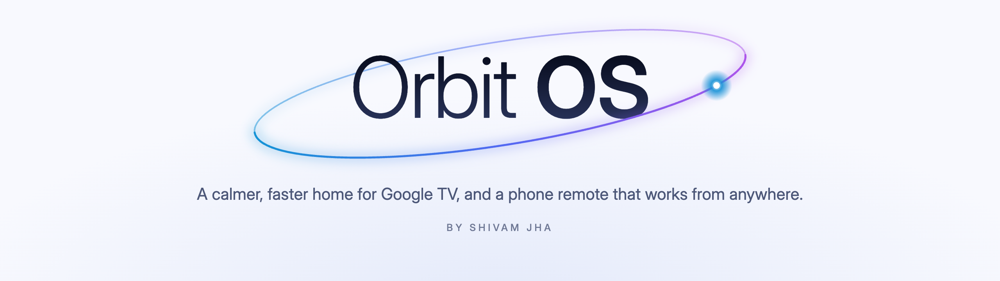
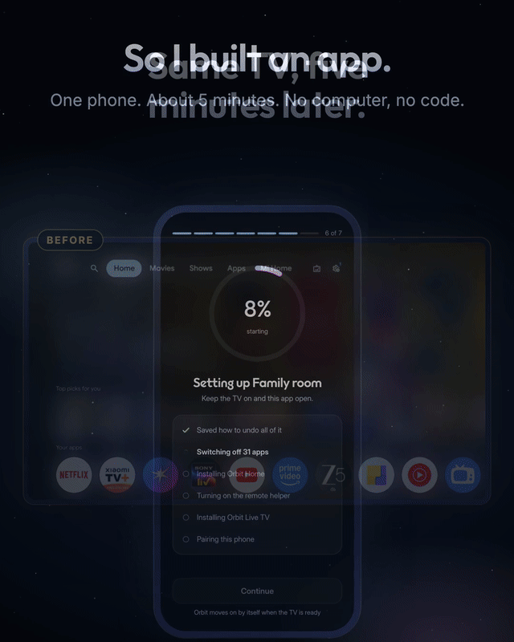
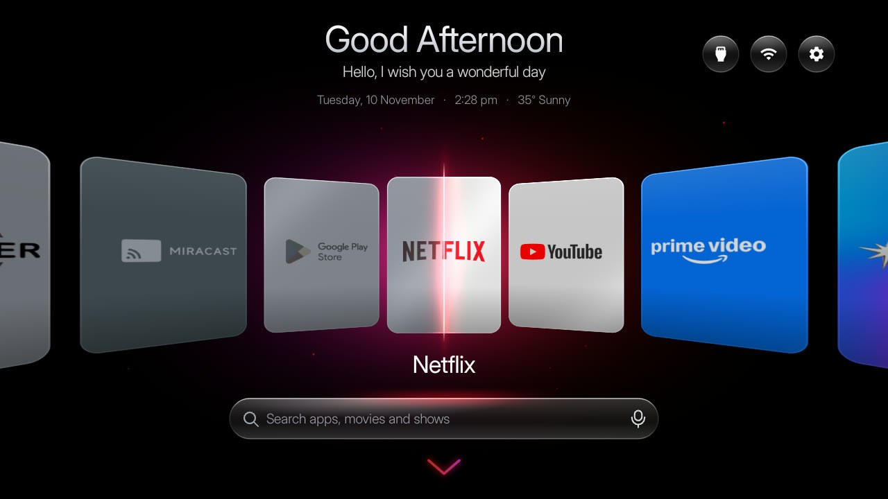
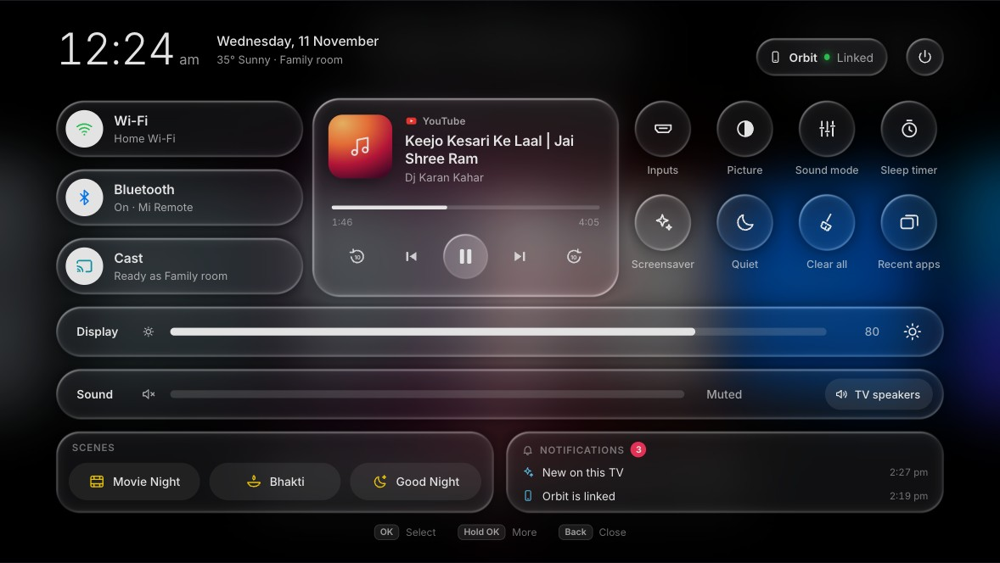
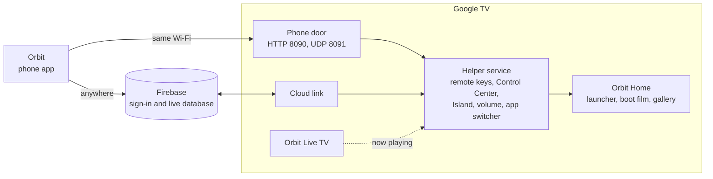

<p align="center">
  <picture>
    <source media="(prefers-color-scheme: dark)" srcset="docs/assets/banner-dark.png">
    
  </picture>
</p>

<p align="center">
  <a href="#what-you-get">What you get</a> ·
  <a href="#how-it-works">How it works</a> ·
  <a href="#build-from-source">Build from source</a> ·
  <a href="#contributing">Contributing</a> ·
  <a href="#roadmap">Roadmap</a>
</p>

<p align="center">
  <a href="LICENSE"></a>
  
  
  
  <a href="https://play.google.com/store/apps/details?id=dev.shiv.orbit"></a>
</p>

Orbit OS replaces the stock home screen of a Google TV with its own: a curved gallery of your apps, a pull-down
Control Center, notifications that glow along the top edge, a Live TV app and a film that plays when the TV starts.
**Orbit**, the phone app, is its remote, on the same Wi-Fi or from anywhere, down to seeing the TV's screen and
pressing its buttons for someone at home. It also puts Orbit OS on the TV in the first place, from the phone, with
no computer.

It runs on top of Google TV: no root, no unlocked bootloader, no factory reset. What it switches off is disabled,
never uninstalled, and one tap of Undo brings the TV back the way it was.

Orbit OS is open source, under the GNU General Public License v3.0 or later. It is made in India by
[Shivam Anil Jha](https://shivamjha.dev/).

<p align="center">
  
</p>

<p align="center">
  <a href="https://play.google.com/store/apps/details?id=dev.shiv.orbit&referrer=utm_source%3Dgithub%26utm_medium%3Dreadme"></a>
</p>

<p align="center"><b>Try it on your TV tonight:</b> free, no ads, set up from your phone in about five minutes, and undone in one tap.<br>
If Orbit is useful to you, a ⭐ on this repository helps other TV owners and developers find it.</p>

<p align="center">
  
  
</p>

## What you get

### On the TV

| Feature | What it does |
|---|---|
| **Boot film** | A short film, *Developed by Shiv*, plays once per start-up and cuts straight into Home. Any key skips it. |
| **Gallery Home** | Your apps on a curved row of glass cards, lit in each app's own colour. Search and voice search across apps, movies and shows. A greeting with the time of day, the date, the weather and festival colours. |
| **Control Center** | The remote's Settings button pulls down a glass panel: Wi-Fi, Bluetooth, Cast, inputs, picture and sound modes, a sleep timer, screensaver, quiet mode, clear memory, recent apps, display and volume sliders, scenes and notifications. The gear opens the TV's full Settings. |
| **Now playing** | What is playing, when it ends, lyrics for songs and bhajans, pause after 15, 30 or 60 minutes, subtitles, and "continue on your phone". Volume is remembered for each app. |
| **Island** | Short notices glow along the top edge of the screen: headphones and their battery, network lost and back, HDMI, codes for the phone, app notifications. |
| **Video shelf** | Home during a video raises your apps over the picture while it keeps playing (this TV has no picture-in-picture). |
| **App opening** | The card flies forward into the app instead of a black wait; recent apps and back-to-where-you-were with the Home button. |
| **Live TV** | 30 free Hindi channels, News, Serials, Bhakti, Kids and Movies, played only from each channel's own servers, with a guide and channel numbers. Pay channels open in their own apps. |
| **Clean system** | Telemetry, ads and apps nobody uses are switched off, with a one-tap undo. |

### On the phone

<p align="center">
  
</p>

| Feature | What it does |
|---|---|
| **Orbit Setup** | Finds the TV on the Wi-Fi, shows how to turn on its developer options, asks a few plain questions, shows the whole plan, then sets the TV up. Undo puts everything back. |
| **Remote** | A globe-shaped touchpad that moves a pointer on the TV, the D-pad, volume, sleep, and a keyboard that types straight into the TV's search boxes. |
| **From anywhere** | Pair once on the Wi-Fi with the code on the TV; link with Google sign-in and an 8-digit code, and the remote works away from home through the cloud. |
| **Help mode** | See the TV's screen on the phone, menus and apps, and tap it to press buttons for family at home. The TV shows who is watching, and help ends by itself. |

### In your language

The phone app and Orbit Home speak every language Android offers, about 80, from Afrikaans to Zulu: Hindi and the
other Indian languages, Brazilian Portuguese, Arabic and Urdu (right to left), Chinese, Japanese and the rest.
- The app follows your phone's language; Settings › Language picks another.
- The TV follows its own language.
- The translations are new, and help from native speakers is welcome:
  [fix a translation](tools/i18n/README.md#fix-a-translation).

<p align="center">
  
</p>

### Prefer to do it by hand?

The website has plain guides with the ADB commands and the safe list Orbit uses:
[remove ads from the Google TV home screen](https://orbit-os-tv.vercel.app/guides/remove-ads-google-tv.html) ·
[debloat Google TV and Android TV](https://orbit-os-tv.vercel.app/guides/debloat-google-tv.html) ·
[Xiaomi TV: remove ads and PatchWall promotions](https://orbit-os-tv.vercel.app/guides/xiaomi-tv-remove-ads.html) ·
[turn on USB debugging](https://orbit-os-tv.vercel.app/guides/turn-on-usb-debugging-google-tv.html) ·
[हिंदी में](https://orbit-os-tv.vercel.app/guides/android-tv-ads-band-kaise-kare.html)

New to the phone remote? [The Orbit phone remote, step by step](docs/guides/phone-remote.md) ·
[em português](docs/guides/phone-remote.pt-BR.md)

## How it works

Orbit OS is two apps on the TV, one on the phone, and the script that sets a TV up. Nothing in the TV's firmware
changes.

- **Orbit, the phone app** (`phone/`), is a Flutter shell around a web page. The whole interface is React and
  TypeScript in `phone/ui`, built by Vite into one self-contained `index.html` that the app shows in a full-screen
  WebView. The page never talks to the network itself: it asks the Flutter side through a small JSON bridge, and
  Flutter finds the TV, pairs with it, keeps the token and talks to it. Opened in a desktop browser, the page uses a
  built-in pretend TV, so the interface can be worked on without a phone or a TV.
- **Orbit Setup** puts Orbit OS on a TV from the phone. A pure-Dart ADB client (`phone/app/lib/setup/adb.dart`; the
  app's RSA key is kept and used by `AdbKey.kt`) opens the TV's own debugging connection once someone presses Allow
  on the TV, sends the two TV apps and the setup script, and runs that one script, `setup/tv/orbit-setup.sh`, in the
  TV's own shell. The script writes down how the TV was before it changes anything and adds every change to an undo
  record as it makes it; `setup/tv/orbit-undo.sh` reads that record to put the TV back. It switches apps off and
  never uninstalls a factory app.
- **Orbit Home** (`launcher/app`, Java) is the home screen, with a helper service that takes the remote's keys, draws
  the Control Center and the Island over other apps, and opens the door the phone talks to: HTTP on port 8090 and the
  pointer on UDP 8091, answered on the home network only.
- **Orbit Live TV** (`launcher/livetv`) plays the free channels with Media3 ExoPlayer, each only from its own
  broadcaster's servers.
- **From anywhere**, the phone and the TV sign in to the same Firebase account and pass commands and replies through
  the Realtime Database, whose rules (`phone/firebase/database.rules.json`) keep each account to its own data.
- **The website** (`site/`) is a separate Vite and React page, built into one `index.html`.



More in [docs/architecture.md](docs/architecture.md). The contract between the phone and the TV, down to every bridge
op, HTTP route and line the setup script prints, is [phone/SPEC.md](phone/SPEC.md).

## Repository layout

| Folder | What is inside |
|---|---|
| [`launcher/app`](launcher/app) | **Orbit Home** (`dev.shiv.orbit.home`): the TV home screen and its helper service (Java, Android 14) |
| [`launcher/livetv`](launcher/livetv) | **Orbit Live TV** (`dev.shiv.orbit.live`): channels, guide and player (Media3 ExoPlayer, HLS) |
| [`phone/ui`](phone/ui) | **Orbit**'s interface: React 19, Tailwind 4, Framer Motion, a WebGL globe |
| [`phone/app`](phone/app) | **Orbit**'s app shell (Flutter): the Wi-Fi and cloud links, Help mode, Orbit Setup's ADB client |
| [`phone/firebase`](phone/firebase) | Database rules for the cloud link |
| [`phone/SPEC.md`](phone/SPEC.md) | The contract between the phone and the TV |
| [`setup/tv`](setup/tv) | Orbit Setup's two TV scripts: `orbit-setup.sh` makes every change, `orbit-undo.sh` puts it back |
| [`devices`](devices) | One folder for each tested TV: what to switch off, its look, its quirks |
| [`tools`](tools) | TV tools over network ADB, for setting a TV up by hand: run commands, push files, switch apps off, undo, push a look |
| [`tests`](tests) | Tests for the TV tools and the setup scripts, and checks of every page's links (pytest) |
| [`site`](site) | The website: one self-contained page, with a playable TV |
| [`docs`](docs) | How it is built, building and installing by hand, the privacy policy, the roadmap |

## Build from source

| To build | You need |
|---|---|
| Orbit Home and Orbit Live TV | JDK 17, Android SDK platform 34 with build-tools 34.0.0 |
| Orbit, the phone app | Flutter 3.47, JDK 17, Android SDK 36, Node 20 or later |
| The website | Node 20 or later |
| The TV tools | Python 3.9 or later |

### The TV apps

```bash
cd launcher
./gradlew :app:assembleRelease :livetv:assembleRelease
```

The APKs land in `launcher/app/build/outputs/apk/release/` and `launcher/livetv/build/outputs/apk/release/`. A release
build is signed with the debug key in `$ANDROID_USER_HOME` (by default `~/.android`), so anyone can build one. Android
installs an update only over an app signed with the same key, so your build cannot update an Orbit Home that came from
Orbit's own releases: put such a TV back with Undo first.

### The phone app

```bash
cd phone/ui && npm ci && npm run build      # the whole interface, as one dist/index.html
cd ../app
tool/sync_ui.sh                             # copies it into the app
tool/sync_setup.sh                          # bundles the two TV apps (build them first) and the TV scripts
flutter build apk --release --target-platform android-arm,android-arm64
```

Two things Orbit's own builds use are not in git, and the build behaves differently without them:

- **The signing key.** A release build is signed with the key that `android/key.properties` names. Without that file
  it is signed with your debug key (Gradle says so), and it cannot update an Orbit installed from Google Play.
- **Firebase.** The build applies Google's services plugin, which stops with "File google-services.json is missing"
  until `phone/app/android/app/google-services.json` exists. Make a Firebase project of your own, register an Android
  app with the package `dev.shiv.orbit` in it, and save its `google-services.json` there; the steps are in
  [docs/build-and-install.md](docs/build-and-install.md#the-cloud-link-optional). Sign-in, the remote from anywhere
  and Drive backups also use the web client ID and database address in `phone/app/lib/cloud/backend.dart`, which name
  Orbit's own project: change them to yours to try those. If Firebase does not start, the app keeps working on the
  home Wi-Fi.

To work on the interface alone, `npm run dev` in `phone/ui` opens it in the browser against the pretend TV.

### The website

```bash
cd site
npm install
npm run build      # type-checks, then writes dist/index.html
npm run dev        # http://127.0.0.1:5290
```

### Put it on a TV

The easy way is Orbit Setup in the phone app. By hand, it takes network debugging on the TV and the tools in
[`tools`](tools); the whole path, from the first "Allow USB debugging?" to the undo, is in
[docs/build-and-install.md](docs/build-and-install.md).

> [!IMPORTANT]
> Signing keys, Firebase settings and each TV's personal settings never go into git. If you publish builds of your
> own, keep a copy of your signing key somewhere safe: an Android app can only be updated by an app signed with the
> same key.

## Run the tests

| Part | In | Command |
|---|---|---|
| Orbit's interface | `phone/ui` | `npm test`, and `npm run build`, which type-checks |
| Orbit's app shell | `phone/app` | `flutter test` and `flutter analyze` |
| Orbit Home and Orbit Live TV | `launcher` | `./gradlew :app:testReleaseUnitTest :livetv:testReleaseUnitTest` |
| TV tools, setup scripts, these pages | the repository's root | `pytest tests`, or with nothing to install `python3 -m unittest discover -s tests -v` |
| The website | `site` | `npm run build` |

A fresh clone of `phone/app` has neither of its asset folders: `tool/sync_ui.sh --placeholder` puts the small
bridge-test page in `assets/ui/`, and `flutter analyze` warns until `assets/setup/` exists, which `tool/sync_setup.sh`
makes (for the analyzer alone an empty folder will do). Neither command needs Firebase settings. The setup scripts'
tests run `orbit-setup.sh` and `orbit-undo.sh` against a pretend TV, so they need no TV either.

## Contributing

Help is welcome: a report of how Orbit runs on your TV, a bug, an idea or code. Start with
[CONTRIBUTING.md](CONTRIBUTING.md); anything that changes a TV follows its safety rules. Everyone taking part follows
the [code of conduct](CODE_OF_CONDUCT.md). A security problem goes in private, as [SECURITY.md](SECURITY.md) says,
never in a public issue.

## Tested on

| TV | System | Since |
|---|---|---|
| Xiaomi TV A Pro, model code MiTV-AXFU0 ([notes](devices/xiaomi-mitv-axfu0)) | Google TV 14 | November 2026 |

Tried it on another TV? A [TV report](https://github.com/shivamj56/orbit-os/issues/new?template=tv-report.yml) helps
the next person with the same set.

## Roadmap

The goal: anyone can put Orbit OS on their TV without a computer, a terminal or a line of code. The plan is in
[docs/roadmap.md](docs/roadmap.md).

- [x] **Orbit Setup from the phone**: install from the phone on the same Wi-Fi. Pictures show how to turn on
  developer mode; questions with big buttons decide what stays; one tap puts everything back (Orbit 1.3.0).
- [ ] **Orbit Setup on the TV itself**: the same pictures and questions on the TV, moved with the remote.
- [ ] **First-run setup on the TV**: your name for the greeting, your email, and a code to pair your phone. No names built in.
- [ ] **One account on TV and phone**: sign in to Orbit with the same email and pair one or more TVs.
- [ ] **Any Android TV or Google TV**: a library of TV models that says what each built-in app does and whether it is safe to switch off.
- [ ] **A remote that fits each TV**: its buttons, inputs and apps.
- [ ] **Tablets.**
- [ ] **Public release**: signed releases on GitHub, a demo video.

## Licence

© 2026 [Shivam Jha](https://github.com/shivamj56). Orbit OS is free software under the
[GNU General Public License v3.0 or later](LICENSE): you may use, study, share and change it, and a changed version
you share goes out with its source, under the same licence.

Some parts keep their own licences, all listed in [NOTICE.md](NOTICE.md):

- Fonts: Inter and Outfit (SIL Open Font License). Icons: Fluent Emoji (MIT) and Material Design icons (Apache 2.0).
- The website's React Bits components keep their MIT + Commons Clause licence and are not under the GPL.
- The GPL covers the code, not the Orbit OS name or icon: a fork that is published needs its own.

<p align="center">If Orbit helps you, a ⭐ helps others find it.</p>
