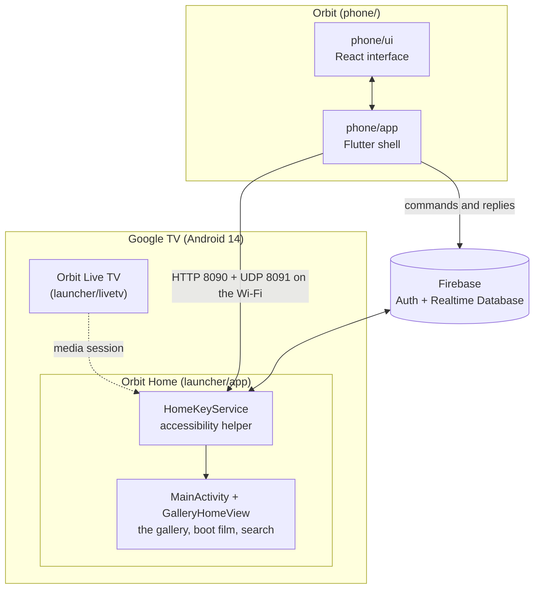

# How Orbit OS is built

Orbit OS is three apps: two on the TV, one on the phone. They meet in the helper service on the TV, which takes
the remote's keys, draws everything that floats over other apps, and opens the door the phone talks to.

## Orbit Home (`launcher/app`)

The home screen. It started as CleanYourTV's launcher and keeps parts of it (wallpapers, the clock, inputs, the
app library, its settings screens and the guards that keep it Home); the gallery, the panel, the Island, the
phone link and the rest below were written for Orbit OS.

Its application id is `dev.shiv.orbit.home`, and Live TV's is `dev.shiv.orbit.live`. The Java packages keep their
first names, `com.gathin.tvhome` and `com.gathin.livetv`, so a component on the TV is written in full, as in
`dev.shiv.orbit.home/com.gathin.tvhome.HomeKeyService`: the short form `dev.shiv.orbit.home/.HomeKeyService` names a
class that does not exist. Until 11 Nov the ids were the Java packages; Orbit Setup moves a TV from those
([phone/SPEC.md](../phone/SPEC.md), "From the earlier ids").

| Part | Files | What it does |
|---|---|---|
| Gallery | `GalleryHomeView`, `GalleryArt`, `GallerySound`, `ScrollCue` | One view: a cylinder of app cards, glass drawn with an AGSL shader, a critically damped spring for motion, the recents page below |
| Boot film | `BootIntro`, `res/raw/boot_intro.mp4` | Once per boot, when the system says it has finished booting; a hard cut into Home, any key skips |
| Greeting | `HomeDays`, `Weather`, `Config` | Time of day, date, weather (Open-Meteo), festival colours to the end of 2027; the name comes from the TV's own settings |
| Search | `SearchActivity` | Keyboard and voice search; "open YouTube" style commands; results inside YouTube and Prime Video |
| App opening | `AppOpening`, `AppReturn`, `AppSwitcher` | The card flies into the app while it starts; Home returns you to where you were; holding Home shows recent apps |
| Recents | `RecentVideos`, `WatchHistory` | What played, read from media sessions and Watch Next, and a way back into it |
| Screensaver | `AmbientS`, `ClockDream` | The S mark in motion, in the TV's own screensaver slot |

### The helper service (`HomeKeyService`)

An accessibility service, so it can take the remote's keys before the system does and draw over other apps.

| Part | Files | What it does |
|---|---|---|
| Remote keys | `RemoteLayout`, `RemoteKeys`, `res/raw/remote_keys*.kcm` | A keyboard layout renames the volume and Settings keys so the stock volume bar never shows |
| Volume | `VolumeSlider` | Its own slider on the screen's edge, held keys repeat smoothly |
| Control Center | `ControlCenter`, `PanelMedia` | The glass panel: a blurred screenshot as the backdrop, one shader per tile, spatial navigation, detail cards |
| Island | `TvIsland`, `IslandEvents` | Notices along the top edge: Bluetooth, battery, network, HDMI, app notifications, codes |
| Video shelf | `VideoShelf` | Home during a video: the apps rise over the picture while it plays |
| Memory | `MemoryClear` | "Clear all" closes background apps through Settings, behind a cover |
| Scenes | `MovieNight`, `CricketScore` | Movie Night dims Home and resumes the newest unfinished film; the cricket score in the Island (needs a free key) |
| Phone door | `PhonePortal`, `PortalHttp`, `PortalQr`, `PointerCursor` | HTTP on port 8090 and the pointer on UDP 8091, paired with a code the TV shows |
| Cloud link | `OrbitCloud` | Firebase over REST and a live stream: commands from Orbit away from home |
| Help mode | `HelpMode` | About twice a second, a 640 x 360 picture of the screen to the phone while someone helps; a note on the TV says who is watching |

The phone door's routes: `/api/pair`, `/api/askcode`, `/api/state`, `/api/key`, `/api/pointer`, `/api/type`,
`/api/volume`, `/api/media`, `/api/apps`, `/api/icon`, `/api/launch`, `/api/open`, `/api/sleep`, `/api/help` and
`/api/screen`. All but `/api/pair` and `/api/askcode` need the token the TV hands out when its code is typed into
the phone.

### Settings

`res/values/config.xml` holds the defaults. A look for one TV lives in a theme folder (`devices/<tv>/theme`), whose
`config.json` overrides those defaults and is pushed with `tools/theme.sh`. Anything personal or secret, a name
for the greeting or the Firebase keys, stays in that TV's own theme on the owner's computer, never in git.

## Orbit Live TV (`launcher/livetv`)

| File | What it does |
|---|---|
| `Channels` | The channel list in `assets/channels.json`, each channel with the servers it may play from; a daily refresh that only takes addresses on those servers; a background check that marks channels "may be off air" |
| `LiveTvActivity` | Media3 ExoPlayer with HLS; Up and Down change the channel; number keys; stalls move to the next stream; a media session so the Control Center shows what is on |
| `GuideView` | The banner and the guide, drawn on one canvas |

## Orbit, the phone app (`phone/`)

| Folder | What it does |
|---|---|
| `phone/ui` | The whole interface as one web page: React 19, Tailwind 4, Framer Motion, GSAP, the WebGL globe. `npm run build` makes `dist/index.html` |
| `phone/app` | The Flutter shell: a WebView with the page, a bridge to native code, finding the TV on the Wi-Fi, the door client, the cloud client, Help mode |
| `phone/firebase` | `database.rules.json`: each account reads and writes only its own `/orbit/{uid}`; a TV writes a link code, a signed-in phone answers it once |
| `phone/SPEC.md` | The contract between the phone and the TV, both on the Wi-Fi and through the cloud |

### Away from home

1. The TV signs in to Firebase anonymously and shows an 8-digit code in the Island.
2. Orbit, signed in with Google, writes its sign-in token under `/link/{code}`.
3. The TV signs in with that token, so the phone and the TV share one account.
4. Commands go to `/orbit/{uid}/cmd`, replies come back in `/orbit/{uid}/res`, the TV's state is in
   `/orbit/{uid}/tv`, and Help mode's pictures are in `/orbit/{uid}/screen`.
