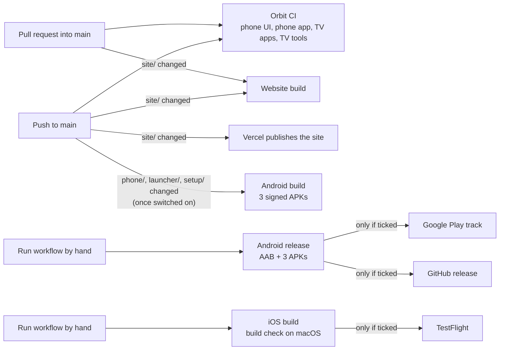

# Builds on GitHub (CI/CD)

GitHub Actions checks every change, builds Orbit's APKs and, only when someone asks for it, builds the Play bundle
and uploads it to Google Play. Today the owner builds releases on the Mac; the signed builds on GitHub are ready and
stay switched off until the signing secrets are added ([Secrets](#6-secrets)).



| Workflow | Runs when | Does | Secrets |
|---|---|---|---|
| [Orbit CI](../.github/workflows/orbit-ci.yml) | a pull request into `main`, a push to `main` (not for `site/`-only changes), or by hand | tests and builds every part, keeps nothing | none |
| [Website build](../.github/workflows/website-build.yml) | a pull request or push that changes `site/`, or by hand | builds `site/dist/index.html` and keeps it as an artifact | none |
| [Android build](../.github/workflows/android-build.yml) | a push to `main` that changes `phone/`, `launcher/` or `setup/` (once switched on), or by hand | the three signed APKs, checked and kept for 30 days | the six signing secrets |
| [Android release](../.github/workflows/android-release.yml) | only by hand | the signed `app-release.aab` and the three APKs; on request a Google Play upload and a GitHub release | the six, and the Play key to publish |
| [iOS build](../.github/workflows/ios-build.yml) | only by hand (macOS minutes cost ten times Linux's) | a build check of the iPhone app, unsigned; on request the signed app sent to TestFlight | none for the check; for TestFlight the App Store Connect key, Firebase's plist and the TV key ([ios.md](ios.md#on-github-instead-optional)) |

Nothing ever publishes to Google Play or the App Store by itself: not a push, not a pull request, not a merge. Nothing
here ever sends Orbit to App Review: that is done by hand in App Store Connect.

## 1. How the checks work

[Orbit CI](../.github/workflows/orbit-ci.yml) runs four jobs side by side on GitHub's Ubuntu 24.04 machines:

| Job | Runs |
|---|---|
| Phone UI (`phone/ui`) | `npm ci`, `npm test` (vitest), `npm run build`, then checks that `dist/index.html` exists |
| Phone app (`phone/app`) | puts the bridge-test page into `assets/ui` (`tool/sync_ui.sh --placeholder`) and makes `assets/setup`, then `flutter pub get --enforce-lockfile`, `flutter analyze`, `flutter test` |
| TV apps (`launcher`) | checks the Gradle wrapper is Gradle's own, `./gradlew :app:testReleaseUnitTest :livetv:testReleaseUnitTest`, then `:app:assembleRelease :livetv:assembleRelease` |
| TV tools (`tools`, `tests`) | `pip install -r tools/requirements.txt pytest==8.4.2`, `python -m pytest tests` |

The checks use no secret. The TV release build in them is signed with the machine's own throwaway debug key: it
proves the build still works, and nothing from it is kept. A failing test or build fails the check. A newer push to
the same branch cancels the older run.

## 2. What starts each workflow

| Event | Orbit CI | Website build | Android build | Android release |
|---|---|---|---|---|
| Pull request into `main` | yes, unless only `site/` changed | if `site/` changed | never | never |
| Push to `main` | yes, unless only `site/` changed | if `site/` changed | if `phone/`, `launcher/`, `setup/` or the build files changed, and the builds are switched on | never |
| Actions › *workflow* › Run workflow | yes | yes | yes | yes, the only way |

Until the builds are switched on, a push run of Android build shows as **skipped** (grey), not failed. To switch
them on, add the secrets and then set the repository variable:

```bash
gh variable set ORBIT_SIGNED_BUILDS --body true --repo shivamj56/orbit-os
```

## 3. Downloading the APKs

1. Open the repository's **Actions** tab and pick **Android build** (or **Android release**).
2. Open a green run. The **Artifacts** list at the bottom of its page has the files; GitHub keeps them 30 days.
3. Each artifact downloads as a zip with the APK, `SHA256SUMS` and `build-info.json` (commit, run, version, sizes).

The run's summary page also shows a table of every file with its package, version, size and signer.

## 4. Building the Play bundle by hand

1. Actions › **Android release** › **Run workflow**.
2. Pick the branch (normally `main`). Leave **Upload the bundle to Google Play** unticked to only build.
3. Optional: type the version you mean (for example `1.4.1+6`). The run stops at once if `phone/app/pubspec.yaml`
   at that commit says something else.
4. The run builds the TV apps, then the phone APK and `app-release.aab`, checks them all and keeps them as artifacts.

A release never falls back to the debug key: if a secret is missing, the first job says which one and stops.

## 5. Publishing to Google Play

Publishing needs one more secret, `GOOGLE_PLAY_SERVICE_ACCOUNT_JSON`, a Google Cloud service account that Play
Console lets release Orbit. Only the Play Console's owner can set it up:

1. In Google Cloud, in a project of your own, turn on **Google Play Android Developer API**.
2. Create a service account there, and a JSON key for it.
3. In Play Console, **Users and permissions** › **Invite new users**: the service account's email, with app
   permissions on Orbit OS to release to testing tracks and to production. New service accounts can take up to a
   day to work.
4. Save the JSON as the secret (it never needs to be opened or pasted anywhere else), then delete the downloaded
   file:
   ```bash
   gh secret set GOOGLE_PLAY_SERVICE_ACCOUNT_JSON --repo shivamj56/orbit-os < service-account.json
   ```

Then, in **Android release** › **Run workflow**:

| Field | Meaning |
|---|---|
| version | Required to publish: exactly the version in `pubspec.yaml`, e.g. `1.4.1+6` |
| Upload the bundle to Google Play | Tick it to upload; unticked (the default) only builds |
| Google Play track | `internal`, `alpha`, `beta` or `production` |
| Play release status | `draft` (the default): the release waits in Play Console for you to finish it. `completed`: it goes out after Google's review |
| Production only | For `production`, type `publish dev.shiv.orbit`; any other track ignores it |
| What's new | Optional release notes in English (en-GB, the listing's language) |
| GitHub release | Also keep the APKs and the bundle as a release named `v1.4.1-build6` |

Before the upload, the bundle is checked again: package `dev.shiv.orbit`, the typed version, and the upload key's
certificate. The upload job runs in the environment `google-play-production` or `google-play-testing`. On GitHub
Pro, Settings › Environments can give `google-play-production` required reviewers, so a production upload also
waits for a click; on the free plan a private repository cannot add those rules, and the typed confirmation is the
guard.

The upload uses [r0adkll/upload-google-play](https://github.com/r0adkll/upload-google-play) v1.1.5, pinned to its
commit.

## 6. Secrets

Add them under **Settings › Secrets and variables › Actions › New repository secret**, or with `gh` from the Mac
as below. Never paste them into a chat, an issue or a commit.

| Secret | What it is | Where it lives on the Mac |
|---|---|---|
| `ORBIT_RELEASE_KEYSTORE_BASE64` | the phone app's release keystore, base64 | `phone/app/android/app/orbit-release.jks` |
| `ORBIT_KEYSTORE_PASSWORD` | its store password | `storePassword` in `phone/app/android/key.properties` |
| `ORBIT_KEY_ALIAS` | the key's alias | `keyAlias` in the same file |
| `ORBIT_KEY_PASSWORD` | the key's password | `keyPassword` in the same file |
| `ORBIT_GOOGLE_SERVICES_JSON_BASE64` | Firebase's Android settings, base64 | `phone/app/android/app/google-services.json` |
| `ORBIT_TV_DEBUG_KEYSTORE_BASE64` | the key both TV apps are signed with, base64 | `debug.keystore` in the `ANDROID_USER_HOME` the TV apps are built with (on the owner's Mac, `work/android-home/`) |
| `GOOGLE_PLAY_SERVICE_ACCOUNT_JSON` | only to publish: the service account's JSON key, as it is | [Publishing](#5-publishing-to-google-play) |

From the repository folder on the Mac, each value goes from the file straight to GitHub without showing on screen:

```bash
R=shivamj56/orbit-os
base64 -i phone/app/android/app/orbit-release.jks | gh secret set ORBIT_RELEASE_KEYSTORE_BASE64 --repo $R
base64 -i phone/app/android/app/google-services.json | gh secret set ORBIT_GOOGLE_SERVICES_JSON_BASE64 --repo $R
base64 -i work/android-home/debug.keystore | gh secret set ORBIT_TV_DEBUG_KEYSTORE_BASE64 --repo $R
sed -n 's/^storePassword=//p' phone/app/android/key.properties | gh secret set ORBIT_KEYSTORE_PASSWORD --repo $R
sed -n 's/^keyAlias=//p' phone/app/android/key.properties | gh secret set ORBIT_KEY_ALIAS --repo $R
sed -n 's/^keyPassword=//p' phone/app/android/key.properties | gh secret set ORBIT_KEY_PASSWORD --repo $R
```

(On Linux, `base64 -w0 FILE` instead of `base64 -i FILE`.) The workflows hand the secrets only to the steps that
need them, as environment variables. [`.github/scripts/signing.sh`](../.github/scripts/signing.sh) writes the files
with mode 0600, never overwrites a file that is already there, prints only the certificates' public fingerprints
and removes the files again at the end of every job, even a failed one. No secret is ever part of an artifact, and
pull requests (forks included) never see one.

## 7. Keeping the signing keys safe

An Android app is updated only by an APK signed with the same key, so these files matter more than the code:

| Key | Signs | Certificate SHA-256 | If it is lost |
|---|---|---|---|
| `orbit-release.jks` | Orbit, the phone app (the upload key for Play, and every APK shared directly) | `168c1033…e79e69a` | Play: ask Google for an upload-key reset (Play App Signing is on). Phones with a directly shared APK: uninstall and reinstall |
| the TV `debug.keystore` | Orbit Home and Orbit Live TV | `ff676c38…ac387a346` | every TV must uninstall Orbit Home and set up again |

- Keep two copies of each, plus `key.properties`, somewhere other than the Mac (an encrypted drive or a password
  manager), and check that the copies open.
- Never make a new keystore for Orbit, and never let a build pick another one: every workflow knows both certificates
  and stops when a key or a finished APK carries another.
- Play re-signs the store version with Google's own app-signing key; `168c1033…` is the upload key Play expects.

## 8. Changing the version

- **Orbit (phone):** `version: X.Y.Z+N` in [`phone/app/pubspec.yaml`](../phone/app/pubspec.yaml) is the only place.
  `X.Y.Z` becomes versionName and `N` versionCode. Every Play upload needs a higher `N` than any before it: 1.4.0 is
  `+5` on Play, so the next is `+6` or more. Commit the change, then run the release.
- **Orbit Home:** `versionCode` and `versionName` in [`launcher/app/build.gradle`](../launcher/app/build.gradle)
  (3.3, 12 today). **Orbit Live TV:** the same in [`launcher/livetv/build.gradle`](../launcher/livetv/build.gradle)
  (1.0, 1). Raise them when the TV app changes.
- CI never edits a tracked file. Every artifact name carries the version and the short commit
  (`orbit-phone-apk-1.4.0-build5-1a2b3c4`), and `build-info.json` adds the run number and time.

## 9. When a build fails

The red step's log names the problem in its last lines. Common ones:

| Message | Cause and fix |
|---|---|
| `Missing secret ORBIT_…` | Add that secret ([Secrets](#6-secrets)) |
| `signing: the … key's certificate is …, not …` | The secret holds another key. Export it again from the right file |
| `verify-apk: … signed by …, expected …` | The APK came out with another key, for example the debug key when `key.properties` was missing. Check the signing step |
| `flutter pub get --enforce-lockfile` fails | `pubspec.lock` does not match `pubspec.yaml`, or Flutter is not 3.47.9. Run `flutter pub get` with 3.47.9 on the Mac and commit `pubspec.lock` |
| `The asset directory 'assets/…' doesn't exist` | `tool/sync_ui.sh` / `tool/sync_setup.sh` did not run before the analyzer or the build |
| `sync_setup: these source files are missing` | The TV APKs were not built first |
| Gradle stops with `OutOfMemoryError` | The runner's heap line in the phone job (`-Xmx4g`) is too small for a bigger app: raise it carefully, the runner has about 8 GB in all |
| `versionCode … has already been used` (Play) | Raise `+N` in `pubspec.yaml` |
| `The caller does not have permission` (Play) | The service account is not invited in Play Console, or is less than a day old |
| A push run of Android build shows as skipped | The builds are not switched on yet ([What starts each workflow](#2-what-starts-each-workflow)) |

To repeat a run, open it and use **Re-run failed jobs**.

## 10. When a release goes wrong

- **The build failed:** nothing left GitHub. Fix it and run the release again; the version is not used up.
- **The upload failed:** Play only applies a complete upload, so Play is unchanged. Re-run the failed job, or the
  whole release.
- **A bad build on a testing track:** release a fixed build with a higher version code; testers get it as an update.
- **A bad build on production:** a staged rollout can be halted in Play Console › Production. A full rollout cannot
  be taken back: Android never installs a lower version code over a higher one, so fix it and release a higher
  version code (rebuilding the earlier code under the new number is the quickest way back).
- **An unwanted draft in Play Console:** discard it there, and still use a new version code next time.
- **A wrong GitHub release:** `gh release delete v1.4.1-build6 --cleanup-tag --repo shivamj56/orbit-os`.

## 11. Which file is which

| Artifact | File | What it is | Goes to |
|---|---|---|---|
| `orbit-phone-apk-<version>-build<code>-<commit>` | `Orbit-<version>.apk` | Orbit, the phone app (`dev.shiv.orbit`), ARM phones | an Android phone (shared directly) |
| `orbit-phone-aab-<version>-build<code>-<commit>` | `app-release.aab` | the same app as a Play bundle | Google Play only |
| `orbit-tv-apks-home-<v>-live-<v>-<commit>` | `OrbitHome-<v>.apk` | Orbit Home, the TV's home screen (`dev.shiv.orbit.home`) | the TV, installed by Orbit Setup from the phone app |
| | `OrbitLiveTV-<v>.apk` | Orbit Live TV (`dev.shiv.orbit.live`) | the TV, the same way |
| `orbit-site-<commit>` | `index.html` | the website (`site/`) | Vercel publishes it |

Every artifact folder also holds `SHA256SUMS` and `build-info.json`. The phone APK carries both TV APKs inside it
(`assets/setup/`), and the build checks they are byte for byte the ones from the same run.

## What every build checks

- The signing key's certificate, **before** the build (`signing.sh`), and the finished file's signer **after** it
  (`verify-apk.sh`, `verify-aab.sh`): exactly one signer, the expected certificate.
- The package name: `dev.shiv.orbit`, `dev.shiv.orbit.home`, `dev.shiv.orbit.live`.
- The phone app's version against `pubspec.yaml`, in the APK and in the bundle.
- `phone/ui/dist/index.html` is the page inside the app, and the TV APKs inside the app are the ones just built.

## Toolchain

The versions match the owner's Mac; change them together, in every workflow that names them.

| Tool | Version | Where |
|---|---|---|
| Runner | Ubuntu 24.04 (`ubuntu-24.04`) | every job |
| Flutter / Dart | 3.47.9 stable / 3.13.7 | `FLUTTER_VERSION`; `phone/app/.metadata` and `pubspec.lock` were made with it |
| Node | 20 | `NODE_VERSION` |
| JDK | Temurin 17 | `JAVA_VERSION` |
| Gradle | 9.3.1 (phone, the wrapper Flutter writes from `gradle-wrapper.properties`), 8.9 (TV, the committed wrapper, distribution checksum pinned) | the wrappers |
| Android Gradle Plugin / Kotlin | 9.1.0 / 2.4.0 (phone), 8.5.2 (TV) | `settings.gradle.kts`, `launcher/build.gradle` |
| Android SDK | compile/target 36, min 24, NDK 28.2.13676358 (phone, Flutter's defaults); compile/target 34, min 26 (TV) | the runner's SDK installs what is missing |
| Python / pytest | 3.12 / 8.4.2 | `PYTHON_VERSION`, the pip line |
| bundletool | 1.18.3, checked against its SHA-256 | `BUNDLETOOL_VERSION`, `BUNDLETOOL_SHA256` |

Every action is pinned to a full commit SHA, with its version in a comment: actions/checkout v7.0.1,
actions/setup-node v7.1.0, actions/setup-java v6.1.0, actions/setup-python v7.1.0, actions/upload-artifact v7.0.2,
actions/download-artifact v8.0.2, subosito/flutter-action v2.23.0, gradle/actions/wrapper-validation v5.0.2 and
r0adkll/upload-google-play v1.1.5. Gradle's own v6 actions are left out on purpose: using them means accepting
Gradle's separate terms for their caching part, and `actions/setup-java`'s cache does the same job. Every workflow
starts with read-only access to the repository; only the GitHub-release job may write, to create the release.

## The website

[Website build](../.github/workflows/website-build.yml) builds `site/` and keeps `dist/` for 14 days. The live site
is published by Vercel's own GitHub connection: Vercel builds `site/` (Vite) from `main` on every push that changes
it, and gives each pull request a preview address. Website-only changes do not start the Android workflows.

## Running the checks on the Mac

The same commands as the workflows, from the repository folder:

```bash
(cd phone/ui && npm ci && npm test && npm run build)
(cd site && npm ci && npm run build)
(cd launcher && ./gradlew :app:testReleaseUnitTest :livetv:testReleaseUnitTest :app:assembleRelease :livetv:assembleRelease)
(cd phone/app && flutter pub get --enforce-lockfile && flutter analyze && flutter test)
python3 -m pytest tests
```
